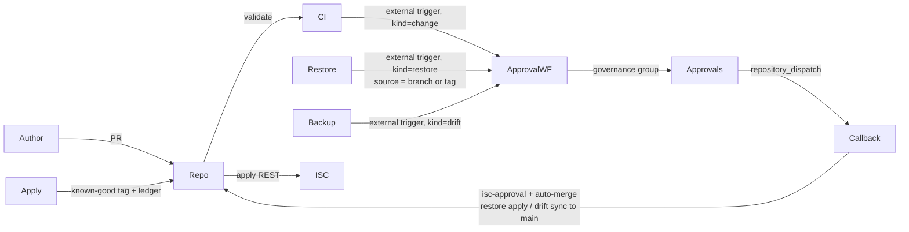

# Access Model Change Management

GitHub-centric governance of SailPoint Identity Security Cloud (ISC) **entitlements** (metadata), **access profiles** and **roles**.

This folder is the **installer and template**. Running the installer creates (or updates) a dedicated GitHub repository wired to one ISC tenant: daily REST backups, pull-request-only changes, ISC Workflow approvals, auto-apply on merge, known-good tags, and governance-group-approved full restore.

## Why not SP-Config?

`sp-config` does not export entitlements. Access profiles and roles can ride SP-Config, but entitlements only support limited metadata updates through the Entitlements API. This project therefore uses each object's REST API end-to-end: dump → edit in git → push back.

## Layout

| Path | Purpose |
|------|---------|
| [`installer/`](installer/) | Node CLI that creates the target GitHub repo and enables the ISC tenant |
| [`template/`](template/) | Files copied into the target repo (scripts, workflows, schemas, `access/`) |
| [`isc/`](isc/) | Workflow export imported into ISC |

## Prerequisites

1. **PowerShell is not required.** Node.js 20+, `gh` (authenticated), and network access to the ISC tenant and GitHub.
2. A **dedicated service identity** in ISC with rights to manage access profiles, roles and entitlement metadata, plus the **Search** user level (`sp:search:read`). Create an API client (client credentials) for that identity — the installer stores it as GitHub Actions secrets so audit events attribute applies to the service identity. Search read lets drift approvals name the actor on the out-of-band edit. Without it, drift detection still runs and the actor is left unknown.
3. At least one **governance group** in ISC. It approves changes, restores, and drift sync.
4. A logged-in `gh` session, plus a **fine-grained GitHub PAT** for ISC→GitHub `repository_dispatch` (see [Dispatch PAT](#dispatch-pat-isc--github) below). The installer asks for this **after** the target repo exists.
5. Permission to create a **GitHub App** (user or org) that the installer configures as the only ruleset bypass actor on `main`.

## Install

From this folder:

```bash
cd "ISC/Access Model Change Management"
npm install
npm run install-tenant
```

The CLI will:

1. Validate `gh` auth and ISC client credentials  
2. Let you pick entitlement **source allowlist** and the **governance group**  
3. Create or update the GitHub repository from [`template/`](template/)  
4. Ask for the **dispatch PAT** (ISC→GitHub callbacks only — or optionally reuse your `gh` login token)  
5. Guide **GitHub App** creation / install (separate from the PAT: bot commits + ruleset bypass) and set repository secrets  
6. Upsert the single `AMCM Approval` ISC workflow, provision its external trigger OAuth client, and enable it  
7. Apply a `main` ruleset (PR-only + required `validate` and `isc-approval` checks). On a free GitHub plan this is skipped for private repositories, and the install continues.  
8. Dispatch the first backup. With an empty `access/` tree and no ledger, that run takes the baseline (a snapshot commit, init ledger entry, and `known-good` tag) instead of opening a drift issue.  

Re-running `install-tenant` is safe against a repo that doesn't have a provisioned `config.yaml` yet (e.g. you created an empty repo by hand and pointed install at it) — the ISC workflow and secrets are updated in place. It refuses to run against a repo that is **already provisioned** (real `config.yaml` present), because its template push is a wholesale overwrite that would replace that repo's live `access/`, `changes/`, and generated `README.md` with empty placeholders. For that case, see **Updating a deployed repo** below.

### Updating a deployed repo

To push a `template/` fix (a workflow, a script, a schema) into a repo that's already deployed and has live access data, use `update` instead of re-running install:

```bash
node installer/cli.mjs update --repo YOUR_GITHUB_OWNER/YOUR_GITHUB_REPO
```

It asks only for the GitHub App ID and the path to its private key — not the full tenant/governance Q&A — reads the deployed repo's own `config.yaml` to refill the `{{PLACEHOLDER}}` values baked into the workflow files, mints a short-lived installation token for that App (so the push lands even with the `main` ruleset active, the same way the repo's own workflows push), and overwrites only:

- `.github/workflows/`
- `scripts/`
- `schemas/`
- `package.json`, `package-lock.json`

It never touches `access/`, `changes/`, `README.md`, `config.yaml`, or `.env.example` — the repo's live data and already-correct deployment config. Run `node installer/cli.mjs update --help` for all options.

### Dispatch PAT (ISC → GitHub)

The ISC workflow calls GitHub `repository_dispatch` when an approval is decided. That call needs a credential stored in the ISC workflow **Configuration** step (`githubDispatchToken`). GitHub does **not** allow creating personal access tokens via the API or `gh`, so the installer opens the creation page in your browser (or accepts a paste).

**Prefer a fine-grained PAT** scoped to the single AMCM repository with **Contents: Read and write**. Do not use a classic PAT or your day-to-day `gh` OAuth token in production tenants — those usually include `repo`, `workflow`, and org scopes across many repositories.

#### Start from the GitHub UI

1. Sign in at [github.com](https://github.com)  
2. Click your **profile photo** (top right) → **Settings**  
3. In the left sidebar, scroll to the bottom → **Developer settings**  
4. **Personal access tokens** → **Fine-grained tokens**  
5. Click **Generate new token**  

Direct link (same screen): [github.com/settings/personal-access-tokens/new](https://github.com/settings/personal-access-tokens/new)

Do **not** use **Tokens (classic)** for this — that is a different, broader token type.

That permission set is enough: `repository_dispatch` only needs **Contents: Read and write**. Leave **Organizations** at 0. Do not add Administration, Workflows, or other repository permissions.

#### User-owned repository

Use when the repo lives under your personal account (resource owner = you).

1. Open the create form via the UI path above  
2. **Token name:** e.g. `amcm-dispatch-<repo>`  
3. **Expiration:** choose a rotation period (e.g. 90 days)  
4. **Resource owner:** your personal account  
5. **Repository access:** Only select repositories → the AMCM repo  
6. Under **Permissions**, open the **Repositories** tab  
7. If **Contents** is not listed yet, click **+ Add permissions** → add **Contents**  
8. Set **Contents** → **Access: Read and write**  
9. Leave **Metadata** as **Access: Read-only** (required; you cannot remove it)  
10. Leave the **Organizations** tab at **(0)**  
11. **Generate token** → copy it once → paste into the installer  

#### Organization-owned repository

Use when the repo lives under an org (e.g. `emea-tes-team/…`).

1. Open the create form via the UI path above (still under **your** user Settings → Developer settings — tokens are always created as you, even for org repos)  
2. **Token name** / **Expiration** as above  
3. **Resource owner:** select the **organization** (not your personal account)  
4. **Repository access:** Only select repositories → the AMCM repo  
5. Same **Permissions** as the user case: **Repositories** tab → **Contents: Read and write**, **Metadata: Read-only**, **Organizations (0)**  
6. **Generate token** → copy it once → paste into the installer  

Org caveats:

- An org owner must allow fine-grained PATs: open the org page → **Settings** → **Personal access tokens** (under Third-party Access / similar) and permit fine-grained tokens. If the org is missing from Resource owner, that policy is blocking you.  
- Some orgs require an owner to **approve** the token before it works. Create it, then ask an owner to approve (org → Settings → Personal access tokens → Pending requests).  
- Prefill URLs can show the wrong owner visually — always confirm Resource owner is the org before generating.  

#### Convenience fallback (installer only)

The installer can reuse `gh auth token` for a quick install. That token is convenient but **broader than needed**. Rotate to a fine-grained PAT afterward by editing the ISC workflow Configuration step (or re-running the installer with `--dispatch-token`).

### Secrets written to the target repo

| Secret | Use |
|--------|-----|
| `ISC_TENANT_URL` | API base |
| `ISC_CLIENT_ID` / `ISC_CLIENT_SECRET` | Service identity client credentials |
| `AMCM_APP_ID` / `AMCM_APP_PRIVATE_KEY` | GitHub App for bot commits |
| `ISC_TRIGGER_URL` | External trigger URL of the single `AMCM Approval` workflow (handles change, restore and drift requests; see [`isc/README.md`](isc/README.md)) |
| `ISC_TRIGGER_CLIENT_ID` / `ISC_TRIGGER_CLIENT_SECRET` | OAuth client the Actions exchange for a token at `{ISC_TENANT_URL}/oauth/token` before calling the trigger |

## Operating model



### Changing an access item

1. Branch from `main`, edit JSON under `access/`.  
2. Open a PR. CI validates schemas and name references.  
3. GitHub calls the **AMCM Approval** workflow with `kind: "change"`. The **governance group** is the only approver. Approvers see the GitHub author, PR title, link and change summary in their ISC **Approvals** inbox.  
4. On approve, GitHub sets the `isc-approval` status (bound to a **diff content hash**, not the commit SHA) and enables auto-merge.  
5. On merge, Actions apply create/update/delete via REST, write new ids back, create a `known-good/…` tag, and append the ledger.  
6. Reject closes the PR. Approvals nobody acts on expire after `approval.timeoutDays` and get the `approval-expired` label; comment `/request-approval` to retry.

Entitlements are **update-only** (name, description, privileged, requestable, owner). Creates/deletes of entitlements are skipped.

### Daily backup and drift

The Backup Action snapshots allowlisted entitlements, all access profiles and all roles. The first run on a repository that has no access files and no ledger commits that snapshot to `main` as the baseline, writes the init ledger entry, and tags `known-good/…`. It does not open a drift issue and it does not wipe history; **Actions → Init** is still the reset. After that baseline, if ISC was edited outside git, nothing is committed to `main` automatically. A drift issue lists every path that fits in GitHub’s 65,536-character body. Paths that do not fit are counted and left to the pull request diff. The drift hash and the pull request link stay in the body. GitHub opens an issue labelled `amcm-drift` holding who changed each item, and a pull request from `drift/<content-hash>` whose Files changed tab is live ISC against git. The pull request body says `Fixes #<issue>`, so GitHub lists it as that issue's resolution. Backup then calls the **AMCM Approval** workflow with `kind: "drift"`, which routes to the **governance group**. The approval description is a single truncated string, so it links to the pull request for the diff and to the issue for the full lists. A `drift/*` head does not request a `kind: "change"` approval. A backup that runs again before anyone decides reuses the open issue. The same file contents reuse the pull request; new contents open a new one and close the previous. Approving merges the pull request (the squash message starts with `chore(backup):`, so Apply to ISC does not push those files back). Rejecting or expiry closes the pull request without merging. The decision callback comments the outcome and closes the issue.

Actors come from the events index, searched since the last time git and ISC matched (or the last 14 days when the ledger has no such point). An `ACCESS_ITEM` event identifies its subject by **name only** — there is no target id on these events — so the search and the matching both work by name and object kind. On approve, the decision callback re-detects drift against live ISC (to make sure the drifted paths haven't moved), refreshes the pull request from that snapshot, merges it into `main`, and records a drift ledger entry whose Who column is those actors. On reject, the callback closes the pull request, restores ISC to match git, and records that. On expiry, the pull request is closed, ISC is left unchanged, and the next scheduled backup asks again. Entitlements this repo cannot create or delete are skipped, so a rejected entitlement-only drift can remain and will be asked about again. Audit search is best-effort: a missing Search user level, or no matching event, leaves the actor unknown and does not block the approval.

### Full restore

1. Actions → **Restore** → **Run workflow** → pick the branch or tag to restore from. The workflow takes no inputs: whatever `access/` holds at that ref is the desired state. `known-good/*` tags are the usual choice, but any ref works — the governance approval is the gate, not the ref name.  
2. A full reconciliation plan is built against live ISC, using the scripts and `config.yaml` from `main` rather than the selected ref.  
3. GitHub calls the same **AMCM Approval** workflow with `kind: "restore"`, which asks the governance group.  
4. On approve, the decision callback re-checks the plan hash against live ISC, applies the plan, reconciles `main` from ISC, and writes a restore ledger entry. A hash that moved since the approval aborts the restore.

Running Restore from a tag created before the workflow dropped its inputs uses that tag's older definition, which still asks for a tag name and still works.

### History

`changes/YYYY-MM/*.json` is the append-only ledger. `README.md` in the target repo is generated from it and lists recent changes, approvals, tags and drift.

### Init

**Actions → Init** starts the repository over. Type `RESET` to confirm. The run stops if any other workflow is still queued or running.

It replaces `main` with one commit: a fresh backup of the current ISC access model (allowlisted entitlements, all access profiles, all roles), a baseline ledger entry, and a new `known-good/…` tag. Scripts, workflows, `config.yaml`, and secrets stay. ISC is not modified. The snapshot is the new baseline, so the next backup should report no drift.

After that commit is on `main`, Init deletes tags, releases, other branches, and previous workflow runs, and closes open pull requests. Issues are deleted when the GitHub App is allowed to; otherwise open issues are closed. GitHub keeps closed and merged pull requests. Git history from before the new commit is gone and cannot be restored from this repository.

Deleting previous workflow runs needs the GitHub App repository permission **Actions: Read and write**. The installer asks for that on a new App. An App created before this permission was listed must get it under the App's **Permissions & events**, then the installation must accept the updated permissions. Without it, Init still replaces `main` and the run fails only on that cleanup step.

## Target repo layout

```
access/
  entitlements/<source-slug>/<name-slug>.json
  access-profiles/<name-slug>.json
  roles/<name-slug>.json
changes/YYYY-MM/
config.yaml
scripts/
schemas/
.github/workflows/
```

Files are keyed by **name slug**; the ISC `id` lives inside the JSON. Cross-references use **names**; apply resolves them to ids in dependency order (entitlements → access profiles → roles). An entitlement name that a caller cannot resolve to exactly one entitlement fails the apply rather than being guessed.

An entitlement is identified by its **ISC id**, which is the only thing about an entitlement that is unique. Names repeat across sources and inside a source, and so do native values: an Entra group aggregates as `group`, `azureADActiveGroup` and `azureADEligibleGroup` entitlements that all carry the same name and the same object GUID, and a PIM role aggregates as both an active and an eligible entitlement. Because identity is the id and not the file name, renaming an entitlement in ISC reads as an update.

Where several entitlements in one source share a name, the file names carry the smallest suffix that tells them apart — native value, else schema object type, else both, else the id:

```
access/entitlements/<source>/accounting__group.json
access/entitlements/<source>/accounting__azureadactivegroup.json
access/entitlements/<source>/accounting__azureadeligiblegroup.json
```

Names that are unique in their source keep the plain `<name-slug>.json`. A backup that cannot give two entitlements distinct paths fails rather than letting one overwrite the other.

## Local commands (inside the target repo)

```bash
npm install
npm run validate
npm run plan
npm run backup          # needs ISC_* env
npm run restore -- --dry-run
npm run readme
npm test
```

## Admins: changing the governance group

Edit the **Configuration** step of the `AMCM Approval` ISC workflow (`governanceGroupId`), or update `config.yaml` in the GitHub repo via PR (used when building approval payloads). Keep them aligned.

## Tests

```bash
cd "ISC/Access Model Change Management"
npm install
npm test
# also:
cd template && npm test
```
