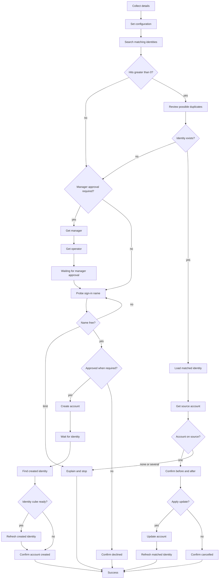

# Identity Match & Onboard

## Purpose

Reference implementation for ISC **interactive identity onboarding** with a **duplicate check**, **collision-safe usernames**, and **manager approval** before account creation. An operator collects personal details and ISC searches for similar identities. A new person can require manager approval before the source account is created. An existing person is shown a before-and-after comparison, and the selected source account is updated only after the operator confirms.

## Overview

The **Identity Match & Onboard** workflow is launched from an interactive process. It:

1. Collects first name, last name, work email, location, and manager.
2. Searches ISC for identities with a fuzzy name match or exact email.
3. If matches exist, presents a review form to pick an existing identity or mark the person as new.
4. If the person is new, finds the first free sign-in name (`jane.smith`, then `jane.smith1`, through `jane.smith20`). When `Manager Approval Required` is `true`, the selected manager approves that exact name before `POST /accounts/v1`. On reject, nothing is created.
5. If the operator selects an existing person, the workflow loads that identity's account on the configured source and shows the current values beside the details already collected. The sign-in name stays as it is. **Yes** updates the account; **No** leaves it unchanged.

Forms use HTML **DESCRIPTION** widgets for operator guidance. The duplicate-review form lists name and email only. The update confirmation uses one full-width before/after comparison.

A demo recording of the earlier end-to-end flow is included as [`Identity Match & Onboard.mov`](Identity%20Match%20%26%20Onboard.mov). It predates the account-update confirmation and username suffix probe.

## Artifacts

| File | Type | Purpose |
|---|---|---|
| `Workflow - Identity Match & Onboard.json` | Workflow export | Interactive onboarding workflow |
| `Forms - Identity Match & Onboard.json` | Form export (array) | All four forms — use for VS Code form import |
| `Identity Match & Onboard.mov` | Demo video | Walkthrough of the interactive experience |

> **Form import format:** The SailPoint VS Code extension expects form exports as a **JSON array** (`[{ version, self, object }, …]`), not a single object. Import `Forms - Identity Match & Onboard.json` to load all forms at once. All fields (including DESCRIPTION widgets) must be nested inside a **SECTION** element. HTML ampersands must be escaped as `&amp;`.

### Exported objects

- **Workflow:** `Identity Match & Onboard`
- **Form definitions:** `Identity Match & Onboard - Onboarding`, `Identity Match & Onboard - Identity deduplication`, `Identity Match & Onboard - Manager approval`, `Identity Match & Onboard - Account update confirmation`

## Architecture



## Workflow steps

| Step | Operator | What it does |
|---|---|---|
| Collect Details | Interactive form | Onboarding form |
| Set Configuration | — | Builds search query, display name, sanitized username, tenant URLs, approval flag |
| Search Identities | — | `sp:get-identities` with identity search query |
| Check Duplicate Count | — | Branches on match count |
| Review Duplicates | Interactive form | Deduplication form (only when matches found) |
| Check Identity Exists | — | Branches on the “This is a new hire” toggle — true when the toggle is No |
| Check Manager Approval Required | — | For a new person, branches on `Manager Approval Required` before the username probe |
| Get Manager | — | `sp:get-identities` by selected manager **uid** |
| Get Operator | — | `sp:get-identity` for the interactive process launcher |
| Notify Waiting For Approval | Interactive message | Tells the operator who will approve |
| Check Username 0–20 | — | `GET /accounts/v1` for the base name, then `name1` … `name20` |
| Manager Approval 0–20 | Standalone form | Approval for the first free name; one step per candidate |
| Create Account 0–20 | — | `POST /accounts/v1` with that free name |
| Show Username Limit Reached | Interactive message | Base name and suffixes 1–20 are all taken |
| Wait For Identity | — | 1 minute pause so the identity cube can appear |
| Find Created Identity | — | Search by the submitted work email |
| Check Identity Created | — | Skips refresh when no identity is found yet |
| Refresh Created Identity | — | `POST /v2025/identities/process` for that identity id (OAuth; experimental header). Failures still show the created confirmation |
| Show Approval Rejected | Interactive message | Decline summary; no account created |
| Load Matched Identity | — | `sp:get-identity` for the selected duplicate |
| Get Matched Account | — | Account on the configured source for that identity |
| Confirm Account Update | Interactive form | Full-width before/after comparison |
| Update Matched Account | — | `POST /accounts/v1` with the existing `id` and `name`, and the other collected values |
| Refresh Updated Identity | — | Processes the selected identity after the update |
| Show Account Updated / Cancelled / Missing / Multiple | Interactive message | Result of the match path |
| Show Account Created | Interactive message | Confirmation summary |
| End Success | — | Workflow complete |

**Trigger:** `idn:interactive-process-launched` (interactive process event).

## Forms

### Onboarding

Collects:

| Field | Type | Source |
|---|---|---|
| First name | TEXT | User input |
| Last name | TEXT | User input |
| Work email | EMAIL | User input; required + email format |
| Location | TEXT | User input |
| Manager | SELECT | `SEARCH_V2` on identities, query `isManager:true` |

The manager field stores the identity **uid** (`attributes.uid`). Display name and email are shown via `attributes.displayName` and `attributes.email`.

### Identity deduplication

Shown only when the search returns one or more matches. The form is **decision-first**: choose whether this is a new hire, then (if not) pick the matching person.

| Field | Type | Notes |
|---|---|---|
| This is a new hire | TOGGLE | Leads the form. Yes = send for manager approval; No = choose a match |
| Matching person | SELECT | Shown only when the toggle is No. Populated from search results (label: name, sublabel: email, value: id) |

Path-specific DESCRIPTION widgets:

- **New hire** (toggle Yes): confirms the selected manager will be asked to approve before a record is created
- **Match helper** (toggle No): short prompt above the person picker

**Form conditions:**

- `newIdentity = true` → hide match helper + person picker; picker optional
- `newIdentity = false` → hide new-hire confirmation; require person picker

### Account update confirmation

Shown after the operator selects an existing person who has exactly one account on the configured source. It does not collect the details again. A description widget renders two full-width columns:

| Column | Source |
|---|---|
| Before | Current account: sign-in name, first name, last name, email, location, and manager |
| After | Sign-in name unchanged; the other values come from the onboarding form |

**Apply these changes** defaults to No. Yes sends the update. The sign-in name row is marked UNCHANGED.

### Manager approval

Standalone form (`sp:forms`), not part of the operator's interactive process. Used only when **Manager Approval Required** is `true`. Assigned to the identity resolved from the selected manager **uid**. Deadline is **2 days**, with a reminder after **1 hour**.

| Field | Type | Notes |
|---|---|---|
| Proposed details | DESCRIPTION | Name, email, sign-in name, and location from form inputs |
| Approve this new hire | TOGGLE | Yes creates the account; No declines |
| Comments | TEXTAREA | Optional note returned to the operator |

The operator sees **Waiting for manager approval** before this form is sent, and either **Onboarding request submitted** or **Onboarding declined** afterwards.

## Duplicate search

The **Identity Query** variable combines fuzzy name and exact email:

```
(attributes.firstname:{firstName}~2 AND attributes.lastname:{lastName}~2) OR attributes.email:"{email}"
```

The `~2` operator allows approximate name matches. Email is matched exactly. Tune the query if your tenant indexes different attribute names.

## Username generation

**Account Name** is derived from `firstName.lastName` and sanitized with Define Variable **Replace** transforms:

1. Remove spaces.
2. Remove characters outside `[A-Za-z0-9.]`.
3. Lowercase A–Z (26 individual replace steps — ISC workflows have no native `toLower`).

Accented characters are stripped rather than transliterated. Adjust transforms if your naming policy differs.

Before creating an account, the workflow checks that name on the configured source. If it exists, it tries the same name with `1`, then `2`, and so on through `20`. The first free value is the one shown to the manager and sent as both `id` and `name`. If all 21 candidates are taken, the operator is told to stop and no account is created.

## Account creation

The **Create Account** HTTP step runs after the manager approves the free sign-in name, or immediately when **Manager Approval Required** is not `true`. After the account is created, the workflow waits one minute, looks up the new identity by work email, and calls `POST /v2025/identities/process` for that identity so lifecycle, roles, and manager correlation run without waiting for the next scheduled processing window. A rejected approval does not refresh an identity. The update path refreshes the identity that was selected. Both writes post to:

```
{ISC API URL}/accounts/v1
```

Request body attribute keys match this **Accounts Source** schema:

| Form / variable | Account attribute | Notes |
|---|---|---|
| Configuration | `sourceId` | Target source UUID (API field, not a schema attribute) |
| Account Name (derived) | `id`, `name` | On create, the first free generated username. On update, the selected account's current `id` and `name` |
| First name | `givenName` | |
| Last name | `familyName` | |
| Work email | `e-mail` | Hyphenated schema name |
| Location | `location` | |
| Manager | `manager` | Identity **uid** (`attributes.uid`) |

`groups` is an entitlement attribute and is not set by this workflow.

`manager` is the selected manager identity **uid**, suitable for manager correlation on a delimited-file source.

> **Important:** The Accounts API creates a record **in ISC** on the named source. It does not provision downstream connector targets. On connector sources, aggregation may remove API-created accounts that do not exist on the target. Flat-file sources are the typical use case.

## Installation

Import order matters. The workflow references form definition IDs, so forms must exist in the tenant first.

1. Import **`Forms - Identity Match & Onboard.json`** (all four form definitions).
2. Import **`Workflow - Identity Match & Onboard.json`**.
3. Complete the tenant configuration below (source id, API/UI URLs, OAuth).
4. Enable the workflow and link it to your interactive process.

## Configuration

### Tenant values (Set Configuration step)

| Variable | Example | Purpose |
|---|---|---|
| ISC API URL | `https://{tenant}.api.identitynow-demo.com` | Accounts API base URL |
| ISC UI URL | `https://{tenant}.identitynow-demo.com` | Base URL for post-match profile links |
| Accounts Source | Source UUID | Replace `xxx` with your target source id |
| Manager Approval Required | `true` | `true` sends the manager form; any other value skips approval |

### OAuth

Configure OAuth credentials on every HTTP step (`paramID`, client id/secret, token URL): username probes, account read, create, update, and both identity refreshes. The client needs permission to list and write accounts on the target source and to process identities. The export leaves `paramID` empty. The repeated username and approval steps are copies, so bind OAuth on each one after import.

### Prerequisites

- Manager search uses `isManager:true` so operators only see identities flagged as managers.
- The selected manager **uid** must resolve to an ISC identity (`attributes.uid`) so the approval form can be assigned.
- A delimited-file (or compatible) **Accounts Source** with attributes aligned to the HTTP body.
- An **interactive process** that launches this workflow.
- Identity profile on the source if you expect identities to be created after aggregation.

### Post-import checklist

- [ ] Forms imported before the workflow.
- [ ] Replace `Accounts Source` placeholder (`xxx`) with your source UUID.
- [ ] Set **ISC API URL** and **ISC UI URL** for your tenant.
- [ ] Bind OAuth on every HTTP step, including each username probe, create, update, and refresh copy.
- [ ] Enable the workflow and link it to your interactive process.
- [ ] Confirm account schema attribute names match the HTTP body (`id`, `name`, `givenName`, `familyName`, `e-mail`, `location`, `manager`).
- [ ] Set **Manager Approval Required** (`true` or skip).
- [ ] Test a new person whose generated name is free, and one whose name is taken so the suffix changes.
- [ ] Test a selected match: **No** leaves the account unchanged; **Yes** updates every field except the sign-in name.

## Limitations

- **Match update needs one source account** — zero accounts stops with an explanation, and more than one account stops because the target is ambiguous. The update does not move the account between identities.
- **Sign-in name is immutable on update** — `id` and `name` are written back from the selected account. The other mapped attributes are replaced from the original form.
- **Username probe stops at 20** — `name21` and later are not tried. ISC workflows have no unbounded loop, so each candidate is an explicit step.
- **Interactive process stays open** on the approval path until the manager submits the form (or the 2-day deadline expires). When **Manager Approval Required** is not `true`, the operator is not blocked.
- **No HTTP error branch** — a failed account write is not handled in this sample. A failed identity refresh still shows the created or updated confirmation.
- **Identity refresh can miss** — `POST /accounts/v1` is asynchronous. If the identity cube is not searchable after the one-minute wait, processing is skipped.
- **Fuzzy name search** can over-match; there is no birthdate or employee-id tie-breaker.
- **OAuth `paramID`** is tenant-specific and left empty in the export.

## Related patterns

- [Dynamic forms and user data collection](../Dynamic%20forms%20and%20user%20data%20collection/) — Accounts API persistence and `SEARCH_V2` form dropdowns.
- [Generic Manager Correlation](../Generic%20Manager%20Correlation/) — manager lookup and correlation across sources.
