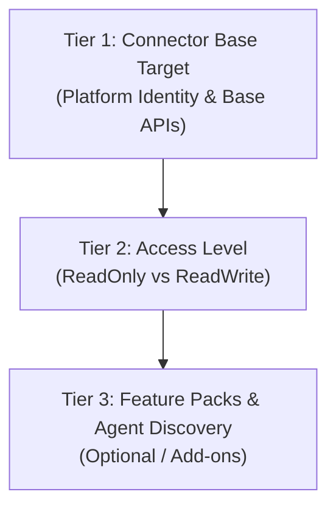

# Connector & Platform Permissions Breakdown

SailPoint Connect organizes cloud permissions using a **3-tier progressive disclosure model**. This model decouples foundational connectivity from governance capabilities and ensures that any generated script or requirements document clearly answers:
1. **What is the baseline connectivity required?**
2. **What changes if we need read-only aggregation vs read-write provisioning?**
3. **What explicit permissions are needed for optional add-ons and AI Agent Governance?**

> [!NOTE]
> **Connectors vs Entro Integrations**: This 3-tier categorization applies strictly to **Connectors (ISC)**. Entro integrations are read-only posture and non-human identity (NHI) analysis engines; they have a single read-only scope and do not utilize read/write levels or optional feature packs.

---

## The 3-Tier Categorization Model

1. **Tier 1 — Base Target (Authentication & Connectivity)**:
   The minimal identity object required in the target platform (IAM role, application registration, or service account) to authenticate with SailPoint ISC.
2. **Tier 2 — Access Level (`ReadOnly` vs `ReadWrite`)**:
   - `ReadOnly`: Aggregation of accounts, entitlements, and groups only. Zero write permissions.
   - `ReadWrite`: Enables identity lifecycle management, provisioning, password resets, and entitlement additions/removals.
3. **Tier 3 — Feature Packs & Agent Discovery**:
   Optional feature modules enabled on the connector (such as Machine Identity Security / Agentic Fabric discovery, Activity Insights, CIEM, etc.).

---

## Platform-by-Platform Matrix

### 1. Amazon Web Services (AWS SaaS Connector)

| Tier | Category | Implementation & Permissions |
|---|---|---|
| **Tier 1** | **Base Target** | IAM Role (`SailPointAWSRole`) with STS trust policy referencing SailPoint's trust principal (`874540850173` Commercial or `229634586956` GovCloud) + `sts:ExternalId`. Attaches `SPAggregationPolicy` (31 IAM read actions) & `SPOrganizationPolicy` (Organizations enumeration). |
| **Tier 2** | **ReadOnly** | Baseline only (`SecurityAudit` + aggregation policies). No user/key mutation. |
| | **ReadWrite** | Attaches `SPProvisioningPolicy` (23 actions: `iam:CreateUser`, `iam:DeleteUser`, `iam:CreateAccessKey`, `iam:PutUserPolicy`, etc.). |
| **Tier 3** | **`AgentDiscovery`** | Attaches `SPAgentDiscoveryPolicy` for **SailPoint Agentic Fabric**: • **Bedrock Agents**: `bedrock:ListAgents`, `bedrock:GetAgent`, `bedrock:ListKnowledgeBases`, `kms:Decrypt`, `kms:GenerateDataKey`. • **Bedrock AgentCore**: `bedrock-agentcore:ListAgentRuntimes`, `bedrock-agentcore:GetGateway`, `bedrock-agentcore:ListWorkloadIdentities`. • **Connect & Lex**: `connect:ListBots`, `connect:DescribeInstance`, `lex:ListBots`, `lex:GetBot`. |
| | **`ActivityInsights`** | Attaches `SPActivityInsightsPolicy` (`cloudtrail:LookupEvents`, `cloudtrail:List*`) + appends `sts:TagSession` to role trust policy. |
| | **`Ciem`** | Attaches `SPCiemPolicy` and provisions CloudTrail S3 bucket log access. |

---

### 2. Google Cloud (Google Workspace & GCP CIEM)

| Tier | Category | Implementation & Permissions |
|---|---|---|
| **Tier 1** | **Base Target** | GCP Service Account (`sailpoint-isc-gws@<project>.iam.gserviceaccount.com`), APIs enabled (`admin.googleapis.com`, `groupssettings.googleapis.com`), and RSA PEM conversion. |
| **Tier 2** | **ReadOnly** | OAuth Scopes: `admin.directory.group.readonly`, `admin.directory.user.readonly`, `admin.directory.rolemanagement.readonly`. GCP Custom Org Role: `cloudasset.assets.searchAll*`, `iam.roles.get`, `resourcemanager.*.get`. |
| | **ReadWrite** | OAuth Scopes: `admin.directory.group`, `admin.directory.user`, `apps.groups.settings`, `admin.directory.rolemanagement`. GCP Custom Org Role: Adds `iam.roles.create/delete/update`, `iam.serviceAccounts.create/setIamPolicy`. |
| **Tier 3** | **`AgentDiscovery`** | Injects Google Vertex AI Agent permissions into custom org role (`aiplatform.agents.get`, `aiplatform.agents.list`). |
| | **`ActivityInsights`** | Appends `admin.reports.audit.readonly`, `admin.reports.usage.readonly`. |
| | **`DomainManagement`** | Appends `admin.directory.domain`. |
| | **`GmailDelegates`** | Enables `gmail.googleapis.com` + Gmail sharing scopes. |

---

### 3. Microsoft Entra ID (Azure)

| Tier | Category | Implementation & Permissions |
|---|---|---|
| **Tier 1** | **Base Target** | Microsoft Entra App Registration (`az ad app create`), Service Principal (`az ad sp create`), and Client Secret. |
| **Tier 2** | **ReadOnly** | Microsoft Graph Application Scopes: `User.Read.All`, `Group.Read.All`, `Directory.Read.All`. |
| | **ReadWrite** | Microsoft Graph Application Scopes: Adds `User.ReadWrite.All`, `Group.ReadWrite.All`, `Directory.ReadWrite.All`, `AppRoleAssignment.ReadWrite.All`. Directory Role: Assigns `User Administrator` for account lifecycle & password management. |
| **Tier 3** | **`CopilotDiscovery`** | Grants `AiEnterpriseInteraction.Read.All`, `Reports.Read.All`, `ExternalConnection.Read.All`, `AppCatalog.Read.All`. Requires adding service principal as an **Application User** in target Power Platform environments. |
| | **`Agent365`** | Configures delegated permissions for Agent 365 catalog (`CopilotPackages.Read.All`, `CopilotPackages.ReadWrite.All`, `offline_access`). |
| | **`AccessPackages`** | Grants `EntitlementManagement.Read.All` or `EntitlementManagement.ReadWrite.All`. |
| | **`MfaManagement`** | Grants `UserAuthenticationMethod.Read.All` or `UserAuthenticationMethod.ReadWrite.All`. |
| | **`AdministrativeUnits`** | Grants `AdministrativeUnit.Read.All` or `AdministrativeUnit.ReadWrite.All`. |

---

### 4. Salesforce SaaS

| Tier | Category | Implementation & Permissions |
|---|---|---|
| **Tier 1** | **Base Target** | Connected App with OAuth Client Credentials (`ConsumerKey`, `ConsumerSecret`) and scopes (`api`, `refresh_token`, `offline_access`). |
| **Tier 2** | **ReadOnly** | View-only administrative permissions. |
| | **ReadWrite** | User provisioning, password management, and permission set assignment. |
| **Tier 3** | **`AgentDiscovery`** | Grants `View Setup and Configuration`, plus read access to `BotDefinition` and `BotVersion` sObjects for Salesforce Agentforce bot governance. |

---

### 5. GitHub SaaS

| Tier | Category | Implementation & Permissions |
|---|---|---|
| **Tier 1** | **Base Target** | Personal Access Token (PAT) or GitHub App credentials. |
| **Tier 2** | **ReadOnly** | Scopes: `read:org`, `read:user`. |
| | **ReadWrite** | Scopes: `admin:org`, `repo`, `user`. |
| **Tier 3** | **`AgentDiscovery`** | Grants `manage_billing:copilot` to discover assigned GitHub Copilot seats and `admin:org` to govern installed GitHub Apps and machine bot users. |

---

### 6. Databricks SaaS

| Tier | Category | Implementation & Permissions |
|---|---|---|
| **Tier 1** | **Base Target** | Databricks Account Service Principal (`SailPoint-source`) and M2M OAuth Secret. |
| **Tier 2** | **ReadOnly / ReadWrite** | Governed through Databricks Account Admin role and Unity Catalog Metastore access. |
| **Tier 3** | **`AgentDiscovery`** | Governs Mosaic AI Agent Framework endpoints and service credentials. |

---

### 7. CrowdStrike Falcon SaaS

| Tier | Category | Implementation & Permissions |
|---|---|---|
| **Tier 1** | **Base Target** | CrowdStrike Falcon API Client (OAuth2 Client ID & Secret) scoped for the target cloud base URL (`https://api.crowdstrike.com`, `https://api.us-2.crowdstrike.com`, `https://api.eu-1.crowdstrike.com`, `https://api.laggar.gcw.crowdstrike.com`). Base Scopes: `hosts:read`, `host-groups:read`, `user-management:read`. |
| **Tier 2** | **ReadOnly** | Baseline only. Aggregates endpoint sensors, host groupings, Falcon console administrator profiles, and assigned roles. |
| | **ReadWrite** | Adds write scopes for automated threat remediation and identity lifecycle: • `hosts:write`: enables network containment (host isolation) and lifting containment via ISC workflows. • `user-management:write`: enables Falcon console administrator account provisioning and role assignments. |
| **Tier 3** | **`Discover`** | Grants `discover:read` for **Falcon Discover** unmanaged asset and machine identity governance: • Discovers unmanaged endpoints, rogue computing devices, and shadow cloud assets. • Aggregates machine accounts into SailPoint Agentic Fabric. |
| | **`IdentityProtection`** | Grants `identity-protection:read` and `identity-protection:write` for **Falcon Identity Threat Protection (ITDR)**: • Correlates compromised credential detections, anomalous identity risk scores, and lateral movement telemetry into SailPoint ISC access certifications and workflows. |
| | **`CloudSecurity`** | Grants `cspm-registration:read` for **Falcon Horizon (CSPM)**: • Aggregates multi-cloud accounts (AWS, Azure, GCP) and cloud security posture misconfigurations. |
| | **`RealTimeResponse`** | Grants `real-time-response:read` and `real-time-response:write` for **Falcon Real Time Response (RTR)**: • Authorizes remote endpoint investigation and automated incident remediation scripts. |
